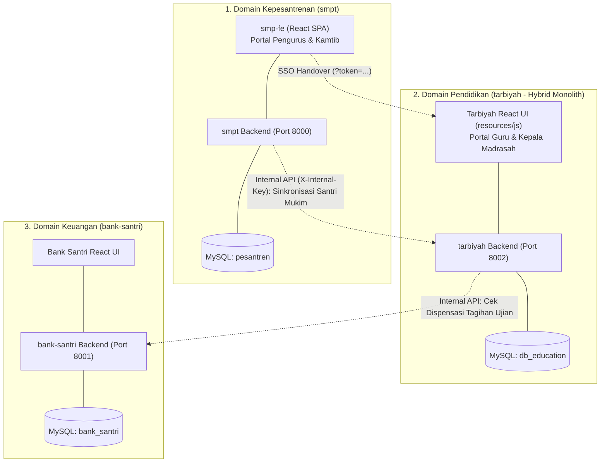

# Proposal Refaktorisasi Arsitektur: Pemisahan Layanan `smpt`

**Dokumen Desain Teknis Pemisahan Domain Pesantren vs. Pendidikan (`tarbiyah`)**  
*Status: Disetujui & Dalam Tahap Eksekusi (In Progress)*

---

## 1. Eksekutif & Latar Belakang

### 1.1 Kondisi Saat Ini

Repositori [`smpt`](file:///Users/rofi/Development/pesantren/smpt) sebelumnya menangani dua domain bisnis besar yang memiliki siklus hidup, karakteristik beban kerja, dan pemangku kepentingan (*stakeholder*) yang berbeda:

1. **Manajemen Kepesantrenan (Kesantrian, Asrama, & Kamtib):** Mengelola siklus hidup santri mukim (PSB, asrama, kamar, perizinan keluar/masuk, pelanggaran/sanksi/takzir, perpulangan liburan, kartu santri, perjanjian wali).
2. **Manajemen Pendidikan & Akademik (`tarbiyah`):** Mengelola institusi pendidikan (formal/diniyah/tahfidz), jenjang/tingkat, kurikulum, mata pelajaran, sesi jam belajar, penugasan guru, rombel/kelas, jadwal pelajaran, presensi harian KBM, penilaian/asesmen, dan buku rapor santri.

Sebelumnya, domain **Keuangan/Perbankan** telah berhasil dipisahkan secara fisik ke repositori [`bank-santri`](file:///Users/rofi/Development/pesantren/bank-santri). Pemisahan domain pendidikan ke proyek baru **`tarbiyah`** menyempurnakan modularitas ekosistem pesantren ini.

---

## 2. Alasan Fundamental Pemisahan Frontend & Backend (Sistem Mandiri)

Berdasarkan analisis kondisi riil di lapangan, sistem pendidikan **tidak cukup hanya dipisahkan di level backend API**, melainkan **harus memiliki antarmuka (frontend) mandiri** yang terpisah dari portal pesantren. Berikut 5 alasan mendasarnya:

1. **Adanya Guru dari Luar Pesantren:**
   - Banyak guru mata pelajaran umum yang bukan staf/pengurus pesantren dan tidak tinggal di asrama.
   - Memberikan akses portal pesantren kepada guru luar membahayakan privasi santri dan membingungkan mereka dengan ratusan menu asrama/kamtib.
   - Guru luar memerlukan portal akademik yang bersih, fokus, dan hanya menyajikan jadwal mengajar, presensi kelas, dan lembar nilai.

2. **Akomodasi Murid Non-Santri (Siswa Kalong / 10%):**
   - Tidak semua murid sekolah/madrasah adalah santri mukim. Terdapat ~10% murid reguler yang datang dari rumah.
   - Pada sistem pesantren monolitik, entitas siswa dipaksa memiliki kamar asrama, lemari, dan izin liburan santri.
   - Di `tarbiyah`, entitas **`Student`** berdiri independen: 90% santri mukim memiliki referensi `santri_id` / NIS, sedangkan 10% siswa luar didaftarkan langsung tanpa atribut kepesantrenan.

3. **Struktur Pendidikan Multi-Jenjang & Multi-Model Kenaikan Kelas:**
   - **Model Formal (SMP/SMA/MTs/MA):** Kenaikan kelas berbasis semesteran dan tahun ajaran kalender kaku.
   - **Model Non-formal / Tahfidz (Leveling Dinamis):** Kenaikan kelas berbasis capaian target hafalan (*milestone/level*) yang **bisa terjadi setiap minggu** begitu santri lulus ujian juz/halaqah.
   - Logika unik ini memerlukan isolasi model dan controller agar tidak mengacaukan sistem tahun ajaran pesantren.

4. **Eliminasi *Cognitive Overload* (Frustrasi Pengguna):**
   - Menggabungkan puluhan modul pesantren + puluhan modul kurikulum dalam 1 menu sidebar menciptakan tumpukan navigasi yang sangat membingungkan administrator dan guru.

5. **Isolasi Beban Komputasi Puncak (*Load Isolation*):**
   - Periode input nilai massal dan cetak ribuan rapor santri di akhir semester menghasilkan beban CPU dan I/O database yang masif.
   - Dengan server dan database terpisah (`db_education` di Port 8002), beban berat akademik tidak akan memperlambat atau melumpuhkan operasional harian pos kamtib, asrama, dan perbankan santri.

---

## 3. Pilihan Arsitektur: Hybrid Monolith Mandiri (`tarbiyah`)

Mengadopsi pola yang telah **terbukti sukses dan stabil pada [`bank-santri`](file:///Users/rofi/Development/pesantren/bank-santri)**:
- **Teknologi Backend:** Laravel 13, PHP 8.4, MySQL (`db_education`), Port `8002`.
- **Teknologi Frontend:** React 19 SPA murni di dalam direktori `resources/js/` proyek Laravel, di-compile menggunakan Vite & Tailwind CSS v4.
- **Tanpa Overhead Inertia.js:** Tidak memerlukan adapter perantara; Laravel Blade (`app.blade.php`) langsung memuat bundle React SPA.
- **Dual Access & SSO Handover:**
  - *Guru Luar:* Login mandiri via `/login` menggunakan email/password lokal `tarbiyah`.
  - *Staf/Guru Pesantren:* Berpindah 1-klik dari portal pesantren melalui rute SSO Handover (`/auth/sso?token=...`) menggunakan shared `JWT_SECRET`.

---

## 4. Diagram Arsitektur Ekosistem

---

## 5. Matriks Pembagian Domain & Entitas

| Kategori | Layanan Pesantren (`smpt`) | Layanan Pendidikan (`tarbiyah`) |
|---|---|---|
| **Pengguna / Guru** | Pegawai/Staf Pesantren (`staff`) | Guru Pengampu (`teachers`): Guru Pesantren + Guru Luar |
| **Siswa / Santri** | Santri Mukim Asrama (`students`) | Siswa Madrasah/Sekolah: 90% Santri Mukim + 10% Siswa Luar |
| **Hunian & Tempat** | Asrama (`hostels`), Kamar (`rooms`) | Ruang Kelas (`classrooms`), Laboratorium |
| **Struktur Belajar**| - | Institusi (`educational_institutions`), Jenjang (`educations`), Rombel (`class_groups`) |
| **Model Kenaikan** | - | **Model A:** Semesteran/Tahunan (Formal) **Model B:** Leveling Mingguan (Tahfidz/Halaqah) |
| **KBM & Kurikulum** | - | Mapel (`studies`), Jam Pelajaran, Jadwal KBM, Presensi Siswa |
| **Evaluasi** | Catatan Perilaku & Takzir | Nilai Harian, Ujian, Rumus Asesmen, Buku Rapor Siswa |
| **Kamtib & Perizinan** | Surat Izin Pulang, Sanksi Pelanggaran | - |

---

## 6. Protokol Integrasi Antar-Layanan (Inter-Service)

1. **Header Autentikasi Internal:** Header `X-Internal-Key` divalidasi oleh middleware `InternalApiKey` di kedua layanan.
2. **Sinkronisasi Santri Mukim:**
   - `tarbiyah` menyediakan endpoint internal `POST /api/internal/students/sync` untuk menerima payload saat ada santri baru/update status di `smpt`.
   - Data lokal `tarbiyah` menyimpan snapshot: `santri_id`, `nis`, `nama`, `gender`, `is_mukim=true`.
3. **Pendaftaran Siswa Non-Santri:**
   - Dilakukan langsung di antarmuka `tarbiyah` (`is_mukim=false`, tanpa `santri_id`).
4. **Dispensasi Ujian:**
   - Saat panitia ujian mencetak kartu ujian, `tarbiyah` memanggil internal endpoint `bank-santri` (`/api/internal/bills/check?nis=...`) untuk memastikan status kelunasan administrasi.

---

## 7. Status Eksekusi

- [x] Inisialisasi Proyek `tarbiyah` (Laravel 13, PHP 8.4, Port 8002).
- [x] Instalasi Dependensi Inti Backend (`jwt-auth`, `spatie/permission`, `activitylog`, `excel`, `dompdf`, `scramble`).
- [x] Instalasi Frontend React 19 SPA, Tailwind CSS v4, Redux Toolkit di `resources/js/`.
- [x] Setup SSO Handover Bridge & Guard API di `routes/web.php` dan `routes/api.php`.
- [x] Database `db_education` siap dengan migrasi dasar.
- [ ] Detail Rencana Kerja & Task List: Mengacu pada [DEVELOPMENT_PLAN_TARBIYAH.md](file:///Users/rofi/Development/pesantren/tarbiyah/docs/DEVELOPMENT_PLAN_TARBIYAH.md).
