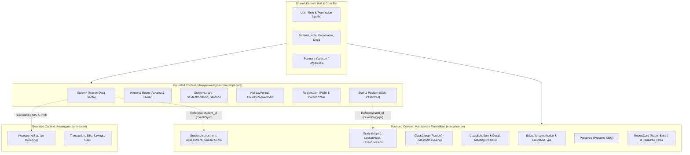
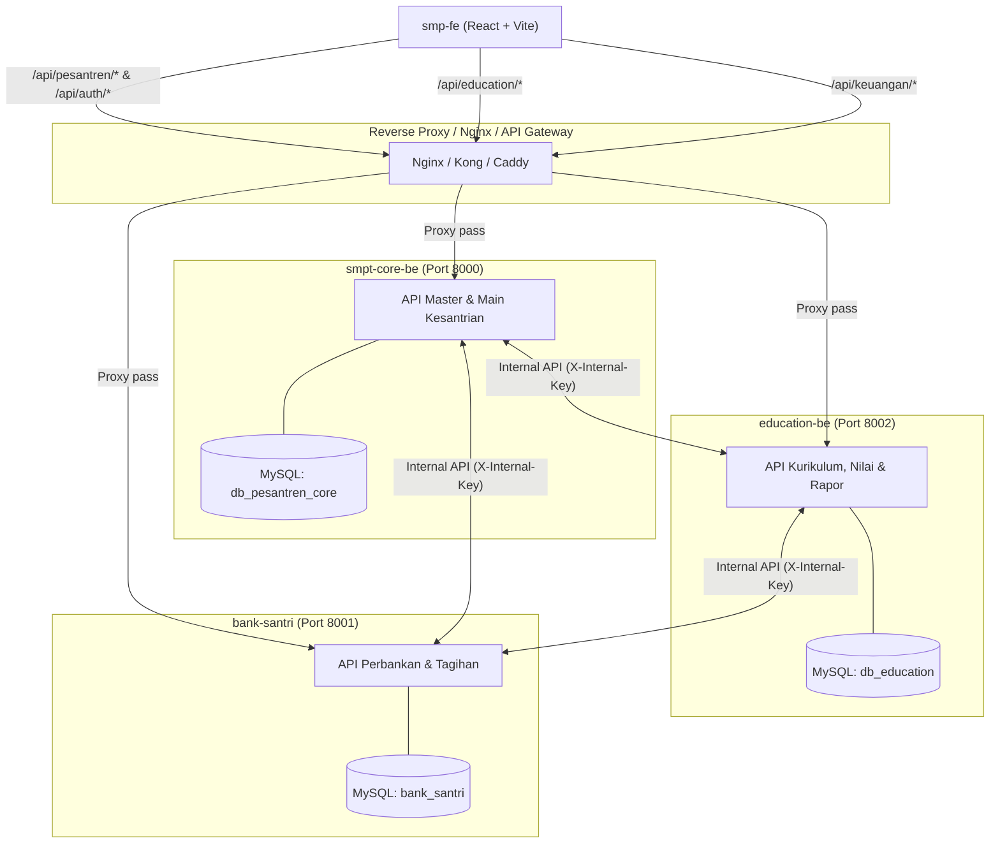
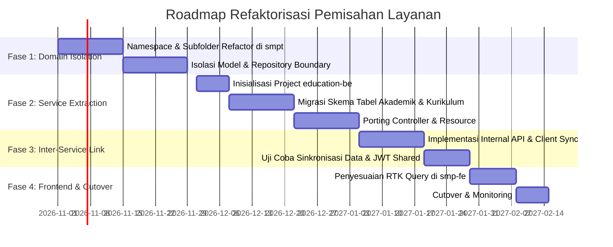

# Proposal Refaktorisasi Arsitektur: Pemisahan Layanan `smpt`
**Dokumen Desain Teknis & Rekomendasi Pemisahan Domain Pesantren vs. Pendidikan**

---

## 1. Eksekutif & Latar Belakang

### 1.1 Kondisi Saat Ini
Repositori [`smpt`](file:///Users/rofi/Development/pesantren/smpt) (Laravel 12 monolitik) saat ini menangani dua domain bisnis besar yang memiliki siklus hidup, pemangku kepentingan (stakeholder), dan karakteristik beban kerja yang berbeda:
1. **Manajemen Kepesantrenan (Kesantrian & Ketertiban/Kamtib):** Mengelola siklus hidup santri (PSB, asrama, kamar, perizinan keluar/masuk, pelanggaran/sanksi/takzir, perpulangan liburan, kartu santri, perjanjian wali).
2. **Manajemen Pendidikan (Akademik & Kurikulum):** Mengelola institusi pendidikan (formal/diniyah), jenjang/tingkat, kurikulum, mata pelajaran, sesi jam belajar, penugasan guru, rombel/kelas, jadwal pelajaran, presensi harian, penilaian/asesmen, dan buku rapor santri.

Sebelumnya, domain **Keuangan/Perbankan** telah berhasil dipisahkan secara fisik ke repositori [`bank-santri`](file:///Users/rofi/Development/pesantren/bank-santri) menggunakan protokol internal API berbasis header `X-Internal-Key` dan webhook callback. Pemisahan domain pendidikan akan menyempurnakan modularitas ekosistem pesantren ini.

### 1.2 Metrik Basis Kode Saat Ini
- **Total Controller:** 70 API Controllers (di bawah `Api/Master` dan `Api/Main`)
- **Total Model:** 69 Eloquent Models
- **Total Migration:** 81 file migrasi
- **Total Baris Kode PHP:** ~31.000 lines of code (LOC)
- **Database:** 1 database MySQL monolitik (`pesantren`)

---

## 2. Analisis Bounded Context (Domain-Driven Design)

---

## 3. Matriks Pembagian Model, Tabel, dan Controller

Berikut adalah pemetaan pembagian beban kerja kode saat ini ke dalam target 2 layanan:

### 3.1 Layanan A: Manajemen Pesantren (`smpt-core-be`)
Fokus pada: **Kehidupan Santri, Ketertiban, Asrama, Kepegawaian, dan Keberadaan Fisik.**

| Kategori | Model / Tabel | Controller Terkait |
|---|---|---|
| **Santri & Wali** | `Student`, `ParentProfile`, `Registration`, `RegistrationFile`, `StudentAgreement`, `StudentResignation`, `StudentCard`, `StudentCardSetting` | `StudentController`, `ParentController`, `RegistrationController`, `StudentCardController`, `StudentCardSettingController`, `StudentAgreementController`, `StudentResignationController` |
| **Asrama & Hunian** | `Hostel`, `Room`, `student_room_assignments` | `HostelController`, `RoomController` |
| **Kamtib & Izin** | `StudentLeave`, `StudentLeaveApproval`, `StudentLeaveActivity`, `StudentLeavePenalty`, `LeaveType`, `StudentViolation`, `Violation`, `ViolationCategory`, `StudentSanction`, `Sanction`, `SanctionType` | `StudentLeaveController`, `StudentViolationController`, `ViolationController`, `ViolationCategoryController`, `SanctionController`, `SanctionTypeController`, `LeaveTypeController`, `DashboardKamtibController` |
| **Liburan Santri** | `HolidayPeriod`, `HolidayRequirement`, `StudentHolidayCheck`, `StudentHolidayRequirementStatus` | `HolidayController` |
| **SDM & Organisasi** | `Staff`, `Organization`, `Position`, `PositionAssignment`, `Employment`, `Profession`, `Occupation` | `StaffController`, `OrganizationController`, `PositionController`, `PositionAssignmentController`, `EmploymentController`, `ProfessionController`, `OccupationController` |
| **IAM & Sistem** | `User`, `Role`, `Permission`, `Menu`, `RoleMenu`, `UserDeviceToken`, `ControlPanel`, `News`, `Activity` | `AuthController`, `RoleController`, `PermissionController`, `MenuController`, `RoleMenuController`, `FcmTokenController`, `ConrolPanelController`, `NewsController`, `ActivityController` |

---

### 3.2 Layanan B: Manajemen Pendidikan (`education-be`)
Fokus pada: **Proses Belajar Mengajar, Akademik, Kurikulum, Penilaian, dan Prestasi.**

| Kategori | Model / Tabel | Controller Terkait |
|---|---|---|
| **Lembaga & Kalender**| `EducationalInstitution`, `EducationType`, `Education`, `EducationClass`, `AcademicYear`, `AcademicQuarter`, `Classroom` | `EducationalInstitutionController`, `EducationTypeController`, `EducationController`, `EducationClassController`, `AcademicYearController`, `AcademicQuarterController`, `ClassroomController` |
| **Kurikulum & Mapel** | `Study` (Mata Pelajaran), `TeacherStudy` / `StaffStudy`, `LessonHour`, `LessonSession` | `StudyController`, `StaffStudyController`, `LessonHourController`, `LessonSessionController` |
| **Rombongan Belajar** | `ClassGroup` (Rombel), `StudentClass` (Penempatan Siswa di Rombel) | `ClassGroupController`, `StudentClassController`, `PenempatanKelas` |
| **Jadwal & KBM** | `ClassSchedule`, `ClassScheduleDetail`, `MeetingSchedule` | `ClassScheduleController` |
| **Presensi Belajar** | `Presence` (Kehadiran Siswa per Pertemuan KBM) | `PresenceController` |
| **Asesmen & Nilai** | `StudentAssessment`, `AssessmentScore`, `AssessmentFormula` | `AssessmentController` |
| **Evaluasi & Rapor** | `ReportCard` (Kalkulasi Rapor), Kenaikan Kelas | `ReportCardController`, `DashboardKurikulumController`, `DashboardPendidikanController` |
| **Magang & Ujian** | `Internship`, `InternshipSupervisor`, `StudentExamDispensation` | `InternshipController`, `IntershipSupervisorController`, `ExamClearanceController` |

---

## 4. Analisis Titik Temu (Coupling) & Solusi Integrasi

Tantangan utama saat memisahkan dua domain ini adalah relasi data yang sebelumnya menggunakan foreign key database relasional (MySQL Foreign Key).

### 4.1 Titik Kritis 1: `Student` (Pesantren) ↔ `StudentClass` & Nilai (Pendidikan)
* **Kondisi Saat Ini:** Tabel `student_classes` dan `student_assessments` memiliki foreign key langsung ke `students.id`.
* **Solusi Layanan Terpisah:**
  1. `education-be` tetap menyimpan kolom `student_id` (UUID / Integer) dan `nis` (string) tanpa foreign key database langsung ke tabel `students`.
  2. Saat `education-be` membutuhkan data profil santri (nama, NIS, jenis kelamin) untuk cetak rapor atau daftar absensi:
     - **Pilihan Real-time:** Panggil endpoint internal `GET /api/internal/students?ids=1,2,3` di `smpt-core-be` menggunakan `X-Internal-Key`.
     - **Pilihan Snapshot/Cache (Direkomendasikan):** `education-be` memiliki tabel lokal `education_students` (berisi ID, NIS, Nama, Gender, Status Aktif) yang disinkronkan via webhook setiap kali ada santri baru/update di `smpt-core-be`.

### 4.2 Titik Kritis 2: `Staff` (Pesantren) ↔ Pengajar/Wali Kelas (Pendidikan)
* **Kondisi Saat Ini:** Guru dihubungkan ke `staff_id` yang merupakan entitas pegawai pesantren.
* **Solusi Layanan Terpisah:**
  - `education-be` menganggap guru sebagai `teacher_id` (yang memetakan ke `user_id` atau `staff_id`).
  - Master akun User tetap terpusat di `smpt-core-be` atau Auth Service.

### 4.3 Titik Kritis 3: Dispensasi Ujian (`StudentExamDispensation` / `ExamClearance`)
* **Kondisi Saat Ini:** Syarat mengikuti ujian akademik memerlukan validasi keuangan (tunggakan di `bank-santri`) dan persetujuan panitia ujian.
* **Solusi Layanan Terpisah:**
  - Alur tetap di `education-be` karena ujian adalah domain akademik.
  - `education-be` memeriksa status tagihan via `bank-santri` (`/api/internal/*`) secara terisolasi.

---

## 5. Target Arsitektur Sistem

### 5.1 Arsitektur Topologi Layanan

### 5.2 Strategi Autentikasi & Otorisasi
- **Shared JWT Secret:** Menggunakan kunci rahasia JWT (`JWT_SECRET`) yang sama antara `smpt-core-be` dan `education-be`.
- **Stateless Validation:** `education-be` dapat memvalidasi token JWT tanpa perlu melakukan query ke database `smpt-core-be` untuk setiap request. Data User ID, Email, Role, dan Accessible Institution IDs di-encode ke dalam payload JWT claim.

---

## 6. Analisis Pilihan Implementasi: Monolitik Modular vs. Microservice Fisik

| Aspek | Opsi 1: Microservice Fisik (Pisah Repo & DB) | Opsi 2: Modular Monolith (1 Repo, Split Module/Domain) | Opsi 3: Hybrid (Pisah Repo, Database Schema Bersama) |
|---|---|---|---|
| **Fokus Domain** | ⭐⭐⭐ Sangat fokus & independen | ⭐⭐ Cukup fokus (terpisah namespace) | ⭐⭐ Terpisah repository |
| **Kompleksitas Deploy** | Tinggi (3 backend terpisah, 3 CI/CD, 3 process) | Rendah (tetap 1 deployment Laravel) | Sedang (2 backend, 1 DB cluster) |
| **Integritas Relasi Data** | Eventual consistency / REST API call | Strict ACID (bisa join & foreign key) | Strict ACID (masih dalam 1 DB engine) |
| **Dampak ke Frontend** | Memerlukan mapping base URL / Gateway | Minimal/Nol (route prefix tetap sama) | Memerlukan Gateway |
| **Resiko Kegagalan** | Sedang - Tinggi (potensi data sync issue) | Sangat Rendah | Sedang |

> [!TIP]
> **Rekomendasi Pendekatan:** Gunakan **Opsi 1 (Pemisahan Fisik)** secara **bertahap (Phased Rollout)**. Ekosistem Anda sudah membuktikan keberhasilan memisahkan `bank-santri`. Pendekatan yang sama (internal key + webhook) dapat diaplikasikan untuk `education-be`.

---

## 7. Roadmap Pelaksanaan Bertahap (4 Fase)

### Detail Tahapan:
1. **Fase 1 (Isolasi Logis di `smpt`):**
   - Rapikan folder controller menjadi sub-domain: `Api/Pesantren/*` dan `Api/Education/*`.
   - Hindari query lintas domain yang menggunakan relasi direct join SQL non-esensial.
2. **Fase 2 (Ekstraksi `education-be`):**
   - Buat repo baru `education-be` (Laravel 12, PHP 8.4, arsitektur identik).
   - Ekstrak 25 file migrasi yang murni domain kurikulum/akademik.
   - Pindahkan 28 controller domain pendidikan.
3. **Fase 3 (Integrasi Antar-Service):**
   - Pasang middleware `internal.key` di kedua service.
   - Siapkan endpoint sinkronisasi profil santri (nama, NIS, status aktif) untuk kebutuhan rapor dan presensi.
4. **Fase 4 (Penyelarasan Frontend `smp-fe`):**
   - Tambahkan API slice baru di `smp-fe` (`src/store/slices/api/educationApi.ts`) dengan base URL menuju `education-be` (atau rute melalui Nginx proxy).
   - Tidak perlu merombak UI React, hanya mengubah target endpoint RTK Query.

---

## 8. Ringkasan Rekomendasi Aksi

1. **Pisahkan menjadi 2 domain backend utama:**
   - **`smpt-be`**: Manajemen Kesantrian, Asrama, Kamtib, dan Kepegawaian Pesantren.
   - **`education-be`**: Manajemen Kurikulum, KBM, Penilaian, Presensi Kelas, dan Rapor.
2. **Pertahankan shared auth (JWT)** agar pengguna (guru/pengurus/wali) tidak perlu login ulang saat berpindah antar modul di [`smp-fe`](file:///Users/rofi/Development/pesantren/smp-fe).
3. **Terapkan pola integrasi yang sama persis dengan `bank-santri`** (header `X-Internal-Key` dan payload sync) untuk menjaga konsistensi standar arsitektur di seluruh ekosistem pesantren.
